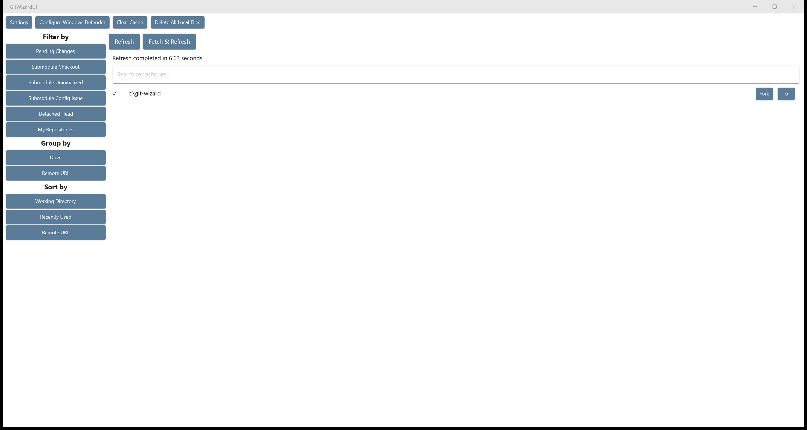

# GitWizard

Scan, organize, and manage all the git repositories on your machine. Find duplicates, spot uncommitted work, and clean up old project copies.



## Features

- **Fast repository discovery** - uses NTFS MFT parsing on Windows for near-instant scanning across all drives
- **Status at a glance** - see pending changes, unpushed commits, and errors per repo
- **Filter** by pending changes, detached heads, submodule issues, or repos you've committed to
- **Group** by drive or remote URL to find duplicate clones; drives group by letter regardless of path case
- **Sort** by path, last commit date, remote URL, or size on disk. Working Directory sorts paths in ascending order (case-insensitive on Windows, ordinal elsewhere), including within groups, and keeps arriving refresh and Live rows in path order
- **Repository sizes** appear beside every row after measurement, with totals on group headers
- **Search** to quickly find repos by path
- **Deep refresh** per repo with remote fetch and index update
- **Live mode** - opt-in repository monitoring (Windows USN journal, Linux fanotify with kernel 5.9+) updates changed, created, deleted, and renamed repositories after one elevation prompt
- **Cross-platform desktop** - Avalonia app runs natively on Windows, macOS, and Linux; library and CLI run everywhere

## Getting Started

Download the latest release from the [Releases](https://github.com/mtschoen/git-wizard/releases) page, or build from source. GitWizard depends on [MFTLib](https://github.com/mtschoen/MFTLib), pulled in as a git submodule and built from source until it ships on NuGet - see `AGENTS.md` for the full per-platform build (native + managed toolchains):

```bash
git submodule update --init

# CLI
dotnet build git-wizard/git-wizard.csproj

# Desktop GUI (Windows / macOS / Linux)
dotnet build GitWizardUI/GitWizardUI.csproj
```

On first run, configure your search paths in Settings. GitWizard will scan those paths for git repositories and cache the results for fast subsequent launches.

### One desktop instance per user

GitWizardUI permits one normal desktop instance per operating-system user,
including across login sessions and launch directories. A second launch reports
`git-wizard is already running` and exits with status 1 without starting another
application window, repository scan, or Live watch. On Windows the message also
appears in a native dialog; dismiss it with OK to let the second launch exit.
On Linux and macOS the message is written to standard error. The existing window
is not automatically activated. Closing the first instance allows a new launch.

Elevated broker and Windows Defender child modes bypass this desktop guard.
The CLI remains independent: this rule does not change its discovery, snapshot,
or watch behavior. The desktop mutex does not prove ownership of an MFT cache
slot; normal library opens may still use a private block when another process
owns that slot.


### Windows discovery scope and caching

Windows discovery uses GitWizard-owned persistent index blocks below
`GetLocalFilesPath()/mft-index/v1-<policy SHA-256 fingerprint>` (normally
`~/.GitWizard/mft-index/...`). The identity includes the `DirectoryIndex` profile and the
normalized retention list `[".git", "HEAD"]`. Changing either selects a different directory;
no old blocks are migrated or deleted by GitWizard.

The stored metadata covers directories and retained marker names across each selected volume,
potentially including other users' directory names. Search, ignore, hidden-directory and
temporary-directory settings filter repository candidates after collection; they do not
restrict the metadata written to the index. Live hydration can add metadata for observed
ordinary files. A process running as your user can read these mapped or backing blocks. MFTLib
protects the supplied cache directory and owns cache validation and locking.

A normal open can reuse a cached block. A concurrent normal open that cannot own its canonical
slot scans into a private delete-on-close block without modifying that canonical block.
Snapshot opening is an explicit session API intent (`MftIndexOpenIntent.Snapshot`): it does not
launch the broker, scan, or start watching. Missing, incompatible, in-use, offline and
identity-failed outcomes remain visible; they are not evidence of an empty repository
inventory. Cache opening and inspection can create lock files and perform library-managed
housekeeping; snapshot means no scan or watch, not a filesystem read-only promise.

A snapshot can be stale. `ScanTimestamp` describes the block's scan age, not a catch-up
completion time. A valid snapshot can retain a lost journal checkpoint; it remains queryable
but cannot resume that checkpoint until an explicit rescan. Later watch or rescan work connects
lazily through the session's owned broker holder. Disposal stops and disposes the index before
detaching broker events and closing the client, including a client first created after opening.

To clear persistent index blocks, run `git-wizard --clear-index-cache`, or open
the desktop sidebar's **Index Cache** section and click **Clear Index Cache**.
The command exits after maintenance and takes precedence over other maintenance,
report and watch flags; it does not scan, request elevation, rebuild a report,
or restart Live. Help/version and invalid arguments are still handled first.

The clear covers the current policy directory and existing direct
`mft-index/v1-<64 uppercase hexadecimal characters>` policy directories,
including superseded v1 policies. Unknown layouts and linked directories are
not traversed. Each canonical block reports its drive, volume serial, path and
`Deleted`, `InUse`, or `Failed` outcome. Busy blocks remain while other drives
are attempted. Failure reasons are shown; CLI exit status is 1 for incomplete
maintenance and 0 for success, including an empty cache. Results are printed
even with `--silent`.

The result includes a new MFTLib `InspectCached` inventory after clearing.
Desktop **Inspect Index Cache** refreshes that inventory independently.
Both deletion results and inventory are point-in-time observations: a different
process can recreate a cache block immediately after deletion.

Clearing never stops Live or releases prepared discovery owners. Stop Live and
close index-owning instances before retrying an `InUse` result. MFTLib owns
locking and deletion; persistent `.lock` siblings, policy directories, retired
siblings and unrelated files remain. Do not manually delete the lock files.
The old **Clear Cache** / `--clear-cache` still only clears report/list files.
**Delete All Local Files** still refuses while the `mft-index` subtree exists,
including after successful block clearing. Configuration and report/list files
are not removed by **Clear Index Cache**. Recursive discovery on Linux and with
`--no-mft` is unchanged.

`git-wizard --index-cache-status` reports the current Windows MFT cache policy's directory, profile, per-volume serial identity, size, directory-entry last-write time and age, validation and availability, then exits without repository discovery, opening an index, or launching an elevated broker. Linux and other platforms report that this cache is not applicable. Do not combine the status flag with cache deletion flags. Exit 0 means the observation succeeded, even when a block is invalid or in use; exit 1 means inspection failed, and exit 2 means the arguments were invalid.

The desktop **Index Cache Status** window provides the same read-only observation and can additionally identify backing owned by its active session. Refresh status updates the observation and age. Inspection can create persistent `.lock` siblings. Availability is point-in-time, not a reservation; an in-use slot does not expose its holder's PID, name, user, or whether it is CLI or UI. Directory-entry last-write time is not the scan timestamp or last successful catch-up. A normal concurrent open may cold-scan into a private block, while a cache-only open refuses with `InUse`.

`DuplicateNames` and `Largest` are inapplicable to repository discovery: discovery does not
group arbitrary duplicate names or rank file sizes. Retaining `HEAD` does not change the
`.git`-based candidate-selection rules.

### Discovery sources, outcomes, and ownership

Every entry point (CLI report/scan/tags/branches, `--watch`, desktop refresh, and Live) runs
through one discovery coordinator. It classifies each expanded search root by filesystem:
NTFS roots use the repository list, a cache-only index snapshot, or a broker scan, while
confirmed non-NTFS roots and explicit `--no-mft` use recursive directory discovery scoped to
those roots. `--no-mft` is the explicit choice for users unable to accept the UAC elevation
prompt; it does not promise an unelevated NTFS journal watch. Bare repositories are found
through retained `HEAD` markers and validated by their `objects` and `refs` layout; internal
`.git` directories and unrelated `HEAD` files are never classified as repositories.

An ordinary (non-watch) refresh reuses `repositories.txt` when the command flags allow it. On
a list miss, Windows discovery first tries a cache-only snapshot without elevation and labels
its scan age; a snapshot can be stale, so it is never treated as current. An explicit rebuild
(CLI `--rebuild-repo-list`, desktop Shift+Refresh) requires a fresh scan and never silently
reuses an old snapshot. Live and `--watch` always reconcile repository membership against the
exact session they watch, replaying journal changes captured during arming, so repositories
created since the last list write enter the inventory even when they produce no later edits.
One Windows index session flows from discovery to the report to the view model to Live; a
prepared owner that is disposed, faulted, or drive-mismatched is disposed and replaced, never
reused.

Each discovery reports one of four outcomes. Complete-empty clears `repositories.txt` and
publishes an empty report. Complete-nonempty publishes normally. Unusable preserves the
previous list and published report, exits the CLI nonzero, and surfaces a UI error, with no
automatic crawl or second elevation attempt. Partial reports the failed drives, keeps
watching healthy ones, and retains cached entries for failed or unobserved scope when
reconciling the list; a partial zero-result is never globally empty. A report-producing CLI
run whose discovery cannot publish a full inventory exits `3` (see
[the report schema](docs/report-schema.md#exit-codes)); explicit `--paths` runs are
unaffected. On Linux, Live and `--watch` install fanotify marks before one recursive
discovery pass per start, then consume queued events; that per-start crawl adds
filesystem-scan latency and uses no MFT cache.

### Temp directories

Discovery (MFT and recursive) and Live monitoring ignore temp directories by default: every
profile's `AppData\Local\Temp` on Windows (any `<drive>:\Users\<name>\AppData\Local\Temp`), the
process's own `%TEMP%`/`%TMP%`, and `/tmp` plus `$TMPDIR` on Linux. CI agents and test suites
create hundreds of short-lived repositories there; tracking them floods the log with refresh
errors for repositories that no longer exist. Set `"includeTempDirectories": true` in
`~/.GitWizard/config.json` (or enable **Include temp directories** in Settings) to include
them again. Explicit ignored paths always apply, and a search path configured inside a temp
directory opts that subtree back in. A repository whose directory vanishes before its refresh
runs is logged at Debug instead of Error.

### Live monitoring

CLI `--watch` arms the platform source first (the Windows index session, or Linux fanotify
marks), then reconciles repository membership against the exact session it watches and
replaces `repositories.txt` only with a publishable outcome. Cached repositories retained
outside the configured search roots stay in scope, including their drives. Repositories
created since the previous cache write are therefore tracked without a rename, and journal
changes captured during arming are delivered after membership is ready instead of being
dropped. Discovery respects the configured ignore, hidden-directory and temp-directory
policies. This adds startup latency at each CLI watch start; it does not
launch an additional MFT broker or elevation prompt. An empty discovery clears the
repository-list cache and the CLI reports that there is nothing to watch; an unusable
discovery preserves the previous list and exits nonzero.

`--watch` prints one `ready:` line when the run is ready and never a second one for the same run:

```
ready: mode=<journal|marks|pump> caught-up=<V[,V...]|-> excluded=<V=<json-string>[,V=<json-string>...]|->
```

`mode=journal` (Windows) means every requested NTFS drive either applied the USN journal backlog
present when its watch armed or is listed under `excluded=` with a reason, and at least one drive
caught up. `mode=marks` (Linux) means the fanotify marks are installed, startup discovery finished
and the event pump is active; fanotify has no historical backlog, so no catch-up fence is claimed.
Reasons are JSON string literals (quotes appear as `\u0022`). `V` is a drive letter on Windows and a
root path on Linux. Total failure, an empty usable drive set, cancellation and source death print no
`ready:` line. With `-v`, every watch line is prefixed with an ISO-8601 UTC timestamp
(`2026-09-23T12:00:00.000Z changed: C:\repo`), and the stream also carries
`startup: <opening|requesting-elevation|broker-connected|scanning <V>|catching-up|discovering|reconciling>`
and `drive: <V> state=<catching-up|caught-up|excluded> origin=<warm|cold|unknown> [reason=<json-string>]`
lines. Without `-v`, `changed:`, `created:` and `deleted:` payloads are unchanged. The broker child
process is diagnostic information only; `ready:` is the readiness evidence.

On Windows, discovery and the transfer into Live share one UAC prompt when the prepared index
is reusable. When one drive's watch fails, MFTLib rescans that drive and restarts its watch by itself; the drive shows as catching up until it is live again, and nothing is reported unless that recovery fails. A drive whose recovery fails, or whose broker channel is lost, is reported while healthy drives stay live. A repository created under a configured search path while Live runs is discovered and tracked from that point on; Live does not need a restart for it. If a drive's cached index checkpoint fell out of the USN journal, Live shows a hint for that drive: a journal of at least the named size would have avoided this rescan, alongside the current maximum size. The named size is a lower bound, rounded up to the journal's allocation unit plus one more unit of margin. When that size is too large to represent, the hint reports the rescan without naming a size. When the journal was recreated (different journal id), the hint says so and offers no size. The same hint also appears the moment a running watch fails because the journal moved past the position the watch had reached, or when a scan's journal catch-up was lost because the journal moved on while the scan ran: live updates for that drive pause, its index keeps answering queries, and the hint says the drive is being rescanned to catch up. A hint from a faulted watch replaces the drive's earlier one, while a watch that fails for any other reason leaves it as it was. If Live ends because no drives remain watchable, the hints stay on screen. CLI `--watch` prints each drive's hint at startup and again when it changes. Nothing is resized automatically.

While Live is running, Settings shows an **Enlarge** button next to each drive hint, enabled where a larger journal would help and otherwise disabled with the reason beside it. It uses the existing
elevated broker session without another broker or UAC prompt, rechecks the current size, and
refuses equal or smaller targets. The result shows the actual before and after sizes in bytes;
Windows may round the requested size upward. **Do not warn again** saves the volume serial in
`config.json` under `ignoredJournalWarnings`, so the preference follows the volume rather than
its drive letter. Re-arming refreshes each drive's hint. Stopping Live releases its resources;
restarting can require a new scan and elevation prompt. Linux fanotify monitoring is unchanged.

The green Live state still means "the pump started". Startup phases remain beside the Live button. The toolbar reserves one nonwrapping readiness line, for example `Ready (journal): C, D`; excluded drives are named in the summary, and later exclusions update that display without another readiness event. Hover over the readiness line or open **Index Cache Status** for each drive's `catching up`, `caught up`, or `excluded` state, its `warm`, `cold`, or `unknown` origin, and any exclusion/failure reason. Both detail views use the same live rows and update as states change. There are no per-drive entries in the toolbar, including during failures. Stopping Live clears the readiness details. A failed watch can leave its index queryable.

### Machine-readable safety sweep

Use the focused sweep mode before travel, migration, or machine maintenance:

```bash
git-wizard --sweep --print-minified
git-wizard --sweep --paths /work/repo-a,/work/repo-b
```

It emits stable JSON containing each repository path, dirty tracked files, local branches with commits absent from all local remote-tracking refs, and stash count. The sweep is read-only and does not fetch, so remote-tracking freshness depends on the machine's last fetch. See [the sweep schema](docs/report-schema.md#repository-sweep-output---sweep) and the local/SSH agent workflow in [skills-dev/sweeping-git-work](skills-dev/sweeping-git-work/SKILL.md).

### Fleet-wide tag and branch inventory

Scan every clone on the machine (including submodule checkouts, nested worktrees, and `~/.pr-crew/repos` when present):

```bash
# Inventory matching tags and verify whether they still exist on any remote
git-wizard tags -m 'archive/*'

# Inventory local branches divergent from default or base branch, with unique-commit counts
git-wizard branches --not-merged main
```

#### Example: Reap tag fleet-wide and prove nothing is left

```bash
# 1. Identify all clones holding the tag and whether remotes still have it
git-wizard tags -m 'archive/2026-01'

# 2. In each clone holding the tag, delete it locally (and on remote if needed)
git-wizard tags -m 'archive/2026-01' | jq -r '.Repositories[].Path' | while read -r repo; do
    git -C "$repo" tag -d archive/2026-01
done

# 3. Prove zero occurrences remain across all repositories and submodules
git-wizard tags -m 'archive/2026-01' --print-minified
# Output: {"SchemaVersion":"1.0","MatchPattern":"archive/2026-01","Repositories":[]}
```

See the [tag and branch inventory schemas](docs/report-schema.md#tag-inventory-output-tags) for schema documentation.

### Preview a PR build

`/preview` on a git-wizard PR builds and publishes the desktop app for Windows or Linux; `scripts/run-preview.ps1` / `scripts/run-preview.sh` download and launch a published preview. Set `GITEA_BASE_URL` to the Gitea origin before running either launcher. See **CI infrastructure → Preview builds** in [AGENTS.md](AGENTS.md).

## Projects

| Project | Description |
|---------|-------------|
| **GitWizard/** | Core class library (cross-platform) |
| **git-wizard/** | CLI tool |
| **GitWizardUI/** | Avalonia desktop app (Windows, macOS, Linux); view models under `ViewModels/` |
| **skills-dev/** | Agent skills developed alongside the CLI |

## License

See [LICENSE](LICENSE) for details.
